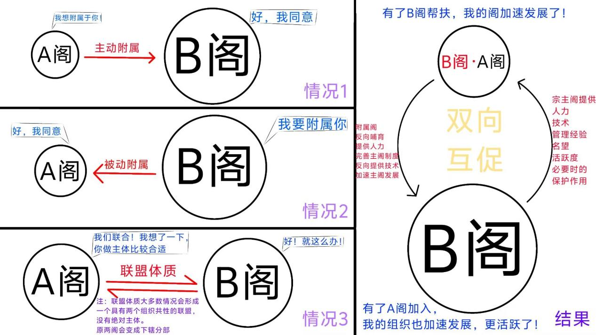
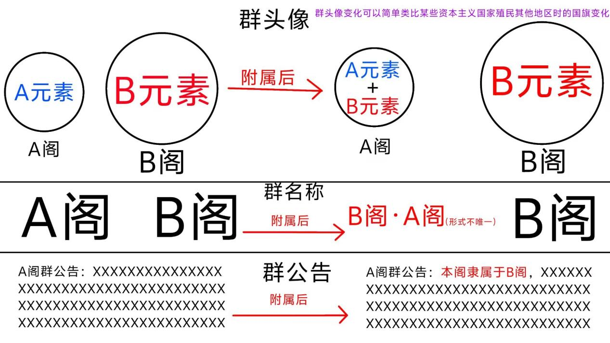
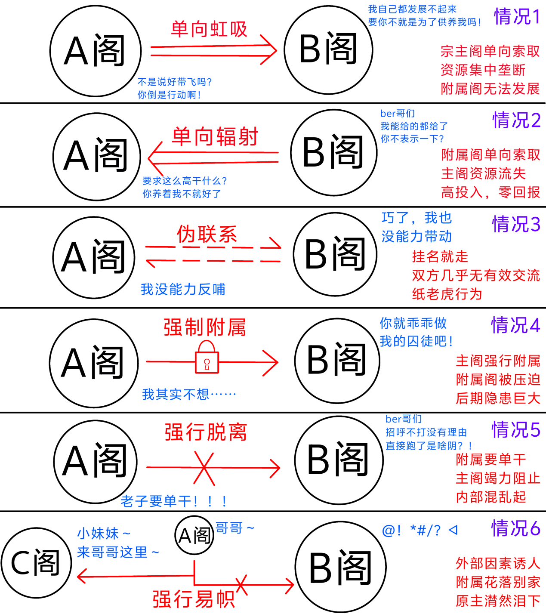

**前言：**

本文章是根据昴星阁，星光阁，星联阁，星球共和阁，前沿社等组织发生的事情以及一些史料创作，由于样本数量稀少（星球圈发展附属的组织非常少），此文章可能难免会出现以偏概全的内容。还请大家多多包涵和指出。

本文章写作的目的是为了让圈友认清附属发展的真实状况，减少不必要的损失。尽管目前发展附属的星球圈组织很少，但其隐患不可忽视。因此，强调其危害性，阐述其现实情况，剖析其本质很有必要。

在生活中我们常常听到“加盟店”“附属网站”等词汇。“加盟”“附属”是很多组织在发展过程中遇到的选择。有些组织通过加盟附属，发展突飞猛进，有些组织则因此出现了很多问题，甚至因此遭受重创。

我相信，生活中的不少人都有野心，都想把某些事物做大做强。如果一个组织领导人手下能有很多附属、分区、基地；如果一个人组建了一个能够呼风唤雨的联盟，那该是多么有面子的事情！

但我在此想说：在当前的星球圈，发展附属/联盟无疑是效率极低，总体弊大于利的行为。

## 附属/联盟是什么？

附属关系：在星球圈内指在一般情况下，一个组织通过某些方式与另一个组织形成不同程度绑定，形成类似宗藩关系的行为。

联盟关系：在星球圈内指在一般情况下，至少两个组织通过某些方式形成不同程度上的互相绑定，形成具有合作性质的联合体的行为

附属关系最重要的一点之一便是双向互促。宗主阁可以为附属阁提供人力、技术、管理经验、名望、活跃度、保护作用等；而附属阁也可以反向给宗主阁回馈人力、技术，完善宗主阁制度，加速宗主阁发展等。二者是一个互利共赢的关系。

广义上来说，联盟关系跟附属关系十分相似。同样地，在非常时期，联盟内部的成员应当在必要的时候互相帮扶；发展时期，联盟内部的成员也应该较为公平合理地享受到发展权及其他必要的权利。

  

附属/联盟关系中，附属阁/联盟成员一般会在群头像、群名称、群公告三个方面中至少选择一个方面体现其附属/联盟关系，具体如下：

  

这样看来，附属发展的确是一个很值得考虑的地方。但是，在星球圈发展附属实际很得不偿失。我们必须看清三大问题：

## “我们在跟谁谈附属？”——星球圈现状不支持发展附属

星球圈现在的热度整体低迷，人员稀少，低龄化严重。一个圈子，连存续和内容创作的问题都不能较好解决，又怎么能支撑得起附属发展？

搞附属需要成本。沟通需要精力，协调维护需要能力，要想让关系长久存续下去，还得有很强的耐心和智慧。如你所见，星球圈中低龄群体人数明显偏多。大部分圈友没有学习过管理知识，没有相关能力，甚至连正确的三观、判断能力、主见等都尚未完全形成。让他们去管理附属，不亚于让文盲管理跨国公司的分公司，结局几乎必定是灾难性的。

星球圈形成的众多群聊和小集体，几乎都是出于兴趣相投才建立的。个人与个人，集体与集体之间的联系并不依靠此类手段。这些只是小团体，并非政治实体。在生命力本就微弱的土壤上强行嫁接本不属于这里的附属“根系”，只会加速养分的消耗。

## “他们眼中的附属是什么”——大部分人对附属的理解错误

附属，本应该是一种双向互促关系，可是很多人都没能正确看待。下面是几种常见的错误附属关系：

  

从星球圈的实际情况来看，我们能看到大量走形的“伪附属”：

- 单向虹吸：宗主阁把附属阁当成自己的资源池，只索取不付出
- 单向辐射：宗主阁一厢情愿地推动附属发展，但附属根本没有反哺能力
- 伪互促：双方都没能力给对方任何正反馈，纯粹挂个名头充门面
- 强行附属：未经对方同意就宣布人家是你的人——这在任何语境下都是不尊重
- 强行脱离与强行易帜：单方面的背弃或转投，带来的只有矛盾与仇恨

这些错误关系的共同点是：它们背离了“双向互促”的本质，变成了单方面的消耗或虚名的堆砌。两个组织之间如果无法形成真正的互补与协同，附属就只是一层经不起推敲的窗户纸。而遗憾的是，在当前星球圈的能力结构和人员构成下，能维持真正双向互促的案例，屈指可数。

## “附属的力量到底有多大？”——不稳定结构必然引发动荡

即便我们假设双方都有良好的意愿，附属本身仍然是一种高度不稳定的关系。它太容易受到外部诱惑、利益变动、人际关系波动等的冲击。

星球圈的历史已经用一次次事件证明了这一点：

2025年6月至8月，昴星阁与星球共和阁为了争夺附属展开了一场毫无意义的“军备竞赛”，大量无意义的附属被仓促建立，最终的结果是什么？星球共和国被联合制裁，昴星阁自身也因频繁混乱陷入长期低谷。这场轰轰烈烈的“竞赛”最终以两败俱伤的局面收场。

同年7月18日，星光阁的附属天宿阁试图改旗易帜投靠昴星阁，险些引发两个组织之间的战争。一个附属的叛离，差点让两个“阁”兵戎相见——这难道不是对“附属促进和平”这一假设的最好反讽吗？

同年9月20日，昴星阁的最大附属昴宿二基地因不愿被束缚而多次独立，同时公开唱衰宗主阁，直接导致昴星阁抖音分部陷入发展低谷期。最亲密的盟友，往往能造成最深的伤害。

进入2026年，历史仍在重演。前沿社意图同时附属多个群聊并实行独裁管理，结果引发下辖分部集体叛乱，组织解体。中天协的领导人尘蔚因推崇“星球球至高无上”而贬低星球圈，引发长时间的跨圈争论，圈内氛围持续恶化。星联阁也曾遭遇附属脱离甚至反叛为敌对势力的窘境……

这些事件贯穿着同一个逻辑：附属关系在低龄化、情绪化、缺乏成熟契约精神的圈层环境中，不仅无法带来稳定，反而成为冲突的策源地。

## 星球圈真正需要什么？

试问：星球圈最稀缺的资源是什么？

是内容，是创作，是真正有价值的科普与交流。

抖音星圈需要的是更多优质的视频、更有趣的天文话题、更能吸引路人的创意表达；B站星圈需要的是扎实的学术讨论、严谨的科普态度、健康开放的交流氛围。

这些，没有一样是通过发展附属能获得的。

当两个阁把精力耗费在谈判附属条件、争夺附属对象、处理附属叛离纠纷时，他们本可以用来创作内容、提升质量的时间与心力，正在无声流失。与其费心经营一段脆弱的“宗藩关系”，不如脚踏实地做好自己的内容、带好自己的成员。一个组织真正的吸引力，永远来自于它自身的价值产出，而不是它名义上“管辖”了多少个附属团体。

我并非全盘否定附属这一形式本身。在理想条件下，成熟的、能力匹配的、互相尊重的组织之间，适当的协作关系确实可能产生正向价值。

但在当前的星球圈，在绝大多数参与者心智尚未成熟、内容生产力尚且不足、圈内氛围屡经动荡的背景下，大规模地、盲目地发展附属，无异于在沙地上建塔——费尽心力垒砌，风一吹便轰然倒塌。我们需要的不是更多的附属，而是更扎实的内容；不是虚张声势的“排面”，而是能够真正吸引同好、推动圈层进步的创作与交流。

暂停那些无意义的附属扩张吧。把精力放回天文本身，放回内容本身——这才是星球圈走出低谷的唯一正途。

衷心祝愿星球圈不再为虚名所困，回归热爱天文的初心！

两只可爱的小昴宿·PSPN

